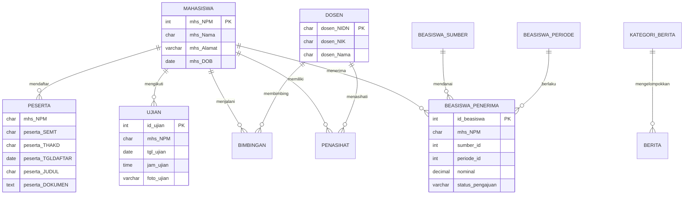
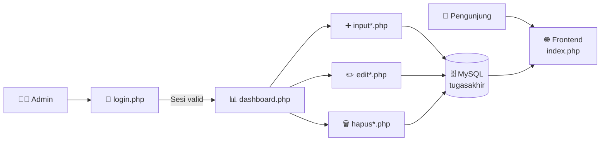

<div align="center">

# 🎓 Sistem Portal Kampus

**Portal akademik berbasis web untuk pengelolaan skripsi, jadwal ujian, beasiswa, berita, dan galeri kampus.**


[Fitur](#-fitur-utama) • [Teknologi](#-teknologi-yang-digunakan) • [Instalasi](#-memulai-proyek) • [Struktur](#-struktur-direktori) • [Database](#️-struktur-database) • [Roadmap](#-catatan-pengembangan-lanjutan)

</div>

---

## 📖 Tentang Proyek

**Sistem Portal Kampus** adalah aplikasi web yang mendemonstrasikan pengelolaan data akademik secara terpusat. Sistem ini memisahkan dua sisi aplikasi:

* **Frontend (Publik):** halaman informasi yang dapat diakses siapa saja, menampilkan data peserta skripsi, jadwal ujian, galeri, dan penerima beasiswa.
* **Admin (Terproteksi):** panel pengelolaan data berbasis sesi login, dengan operasi CRUD lengkap untuk seluruh data akademik.

Proyek ini dikembangkan sebagai tugas akhir mata kuliah **Web Development** dengan studi kasus **Universitas Tarumanagara**.

## ✨ Fitur Utama

### 🌐 Frontend Publik

* **Carousel Banner:** Menampilkan foto kampus dengan slide otomatis.
* **Peserta Skripsi Terbaru:** Menampilkan tiga pendaftar terbaru lengkap dengan judul, NPM, semester, tahun akademik, dan tanggal daftar.
* **Jadwal Ujian Skripsi:** Menampilkan jadwal sidang beserta nama dosen pembimbing.
* **Galeri Dokumentasi Ujian:** Foto kegiatan ujian skripsi yang diambil langsung dari database.
* **Galeri Alumni:** Kartu kegiatan terbaru dari tabel galeri.
* **Informasi Beasiswa:** Daftar penerima beasiswa terbaru beserta sumber, periode, dan nominal, ditambah daftar mitra beasiswa.
* **Menu Dosen Dinamis:** Dropdown nama dosen yang terisi otomatis dari database.
* **Peta Lokasi:** Halaman khusus dengan Google Maps embed lokasi kampus.

### 🔐 Panel Admin

* **Autentikasi Admin:** Halaman login dengan manajemen sesi dan proteksi halaman.
* **CRUD Lengkap** untuk sembilan modul data:

| Modul | Fungsi |
| :--- | :--- |
| 👨‍🎓 Mahasiswa | Data master mahasiswa |
| 👨‍🏫 Dosen | Data master dosen |
| 🧑‍🏫 Penasihat Akademik | Relasi mahasiswa dan dosen penasihat beserta berkas |
| 📝 Peserta Skripsi | Pendaftaran skripsi dan unggah dokumen |
| 📚 Bimbingan Skripsi | Catatan dan berkas bimbingan |
| 🎤 Ujian Skripsi | Jadwal, jam, dan foto dokumentasi ujian |
| 💰 Beasiswa | Penerima, sumber, periode, nominal, dan status pengajuan |
| 📰 Berita | Artikel dengan kategori dan foto |
| 🖼️ Galeri | Publikasi foto kegiatan kampus |

* **Unggah File:** Dokumen dan foto disimpan di direktori `admin/dokumen/`.
* **Layout Admin Responsif:** Sidebar navigasi berbasis template SB Admin (Bootstrap 5).

## 🧰 Teknologi yang Digunakan

| Kategori | Teknologi |
| :--- | :--- |
| Bahasa Pemrograman | PHP 8.2 |
| Database | MySQL / MariaDB 10.4 |
| Koneksi Database | MySQLi |
| Antarmuka | Bootstrap 5, HTML5, CSS3, JavaScript |
| Server Lokal | XAMPP / AppServ |
| Manajemen Database | phpMyAdmin |

## 🚀 Memulai Proyek

### Prasyarat

Pastikan lingkungan pengembangan Anda telah terpasang dan dikonfigurasi dengan benar:
* [XAMPP](https://www.apachefriends.org/) (Apache, MySQL, dan PHP 8.x) atau AppServ
* Peramban modern (Chrome / Firefox / Edge)
* Editor teks atau IDE (VS Code / PhpStorm)

### Instalasi dan Eksekusi

1. Kloning repositori ke direktori web server (`htdocs` untuk XAMPP).
```bash
   cd C:/xampp/htdocs
   git clone https://github.com/darrenevann/SistemPortalKampus.git
```
2. Jalankan modul **Apache** dan **MySQL** melalui XAMPP Control Panel.
3. Buat database baru bernama `tugasakhir` melalui phpMyAdmin (`http://localhost/phpmyadmin`).
4. Impor berkas `tugasakhir (4).sql` ke dalam database `tugasakhir`.
5. Sesuaikan kredensial koneksi database bila berbeda dari bawaan. Ubah **kedua** berkas berikut:
   * `admin/includes/config.php`
   * `frontend/includes/config.php`
```php
   $servername = "localhost";
   $username   = "root";
   $password   = "";
   $dbname     = "tugasakhir";
```
6. Pastikan direktori `admin/dokumen/` tersedia dan memiliki izin tulis (write permission) agar unggahan file berjalan.
7. Buka aplikasi melalui peramban.

| Halaman | URL |
| :--- | :--- |
| 🌐 Frontend Publik | `http://localhost/SistemPortalKampus/frontend/` |
| 🔐 Login Admin | `http://localhost/SistemPortalKampus/admin/login.php` |

### 🔑 Kredensial Default (Development)

| Field | Nilai |
| :--- | :--- |
| Email | `darrenevann1705@gmail.com` |
| Password | `123` |

> ⚠️ Kredensial ini hanya untuk lingkungan pengembangan. Ganti sebelum aplikasi di-deploy ke server publik.

## 📁 Struktur Direktori

```text
SistemPortalKampus/
├── admin/                          # Panel administrasi (terproteksi sesi)
│   ├── bagiankode/                 # Komponen layout reusable (head, menu, menunav, footer, jsscript)
│   ├── includes/
│   │   └── config.php              # Konfigurasi koneksi database admin
│   ├── css/ · js/ · assets/        # Aset Bootstrap dan template SB Admin
│   ├── dokumen/                    # Penyimpanan unggahan file (dokumen, foto ujian, galeri)
│   ├── images/                     # Aset gambar statis admin
│   ├── login.php                   # Halaman login administrator
│   ├── logout.php                  # Proses keluar sesi
│   ├── dashboard.php               # Halaman utama admin
│   ├── settings.php                # Pengaturan akun admin
│   ├── input*.php                  # Form tambah data (mhs, dosen, peserta, ujian, dll.)
│   ├── edit*.php                   # Form ubah data
│   └── hapus*.php                  # Proses hapus data
│
├── frontend/                       # Tampilan publik
│   ├── css/ · js/                  # Aset Bootstrap dan gaya kustom
│   ├── images/                     # Logo dan foto kampus
│   ├── includes/
│   │   ├── config.php              # Konfigurasi koneksi database frontend
│   │   └── frontmenu.php           # Navbar dengan dropdown dosen dinamis
│   ├── index.php                   # Beranda portal
│   └── peta.php                    # Halaman peta lokasi kampus
│
├── tugasakhir (4).sql              # Dump database (struktur dan data awal)
└── README.md
```

## 🗄️ Struktur Database

Sistem menggunakan database **`tugasakhir`** dengan **13 tabel**:

| Kelompok | Tabel | Keterangan |
| :--- | :--- | :--- |
| 🔐 Autentikasi | `admin` | Data akun administrator |
| 👥 Data Master | `mahasiswa`, `dosen` | Data civitas akademika |
| 🎓 Siklus Skripsi | `penasihat`, `peserta`, `bimbingan`, `ujian` | Penasihat akademik, pendaftaran, bimbingan, dan ujian |
| 💰 Beasiswa | `beasiswa_penerima`, `beasiswa_sumber`, `beasiswa_periode` | Penerima, mitra pemberi, dan periode |
| 📰 Konten | `berita`, `kategori_berita`, `galeri` | Publikasi berita dan dokumentasi |

### Diagram Relasi



## 🔄 Alur Aplikasi



Data yang diinput admin akan langsung tampil di halaman publik karena kedua sisi memakai database yang sama.

## 🖼️ Manajemen File Unggahan

Dokumen skripsi, foto ujian, dan foto galeri disimpan pada direktori `admin/dokumen/`. Halaman frontend membaca berkas dari jalur `../admin/dokumen/`, sehingga struktur folder `admin/` dan `frontend/` harus tetap berdampingan. Bila berkas tidak ditemukan, frontend otomatis menampilkan gambar cadangan `images/tes.jpeg`.

## 🛠️ Catatan Pengembangan Lanjutan

Proyek ini masih dalam tahap pengembangan. Beberapa peningkatan yang direkomendasikan:

- [ ] Ganti penyimpanan password plaintext dengan `password_hash()` dan `password_verify()`
- [ ] Gunakan *prepared statements* (`mysqli_prepare`) untuk mencegah SQL Injection pada login dan form CRUD
- [ ] Lindungi semua halaman `input*`, `edit*`, dan `hapus*` dengan pengecekan sesi
- [ ] Validasi tipe dan ukuran berkas unggahan
- [ ] Lengkapi dashboard admin dengan statistik ringkasan dan grafik
- [ ] Pindahkan konfigurasi database ke satu berkas bersama atau file `.env`
- [ ] Tambahkan relasi *foreign key* antar tabel di database
- [ ] Tambahkan fitur pencarian dan paginasi data

## 👨‍💻 Pengembang

**Darren Evan Nathanael**
Universitas Tarumanagara — Tugas Akhir Web Development

[](https://github.com/darrenevann)

---

<div align="center">

⭐ Jika proyek ini bermanfaat, jangan lupa beri **star** pada repositori ini!

</div>
